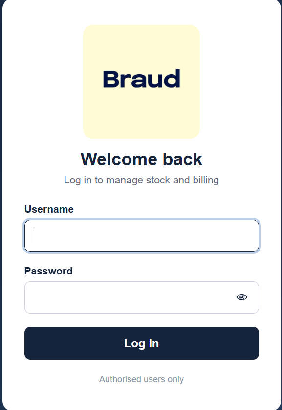
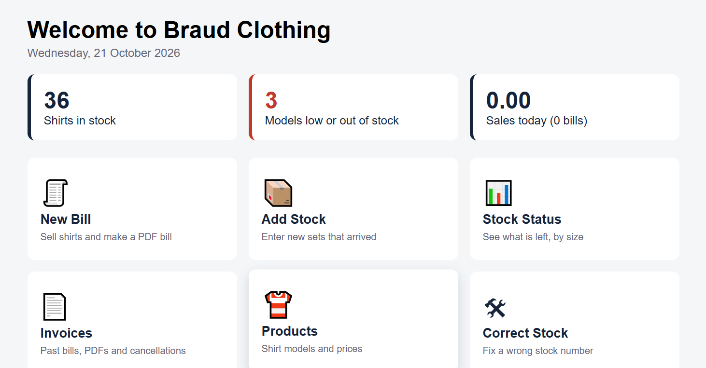
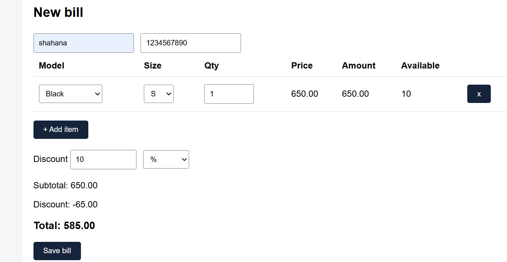
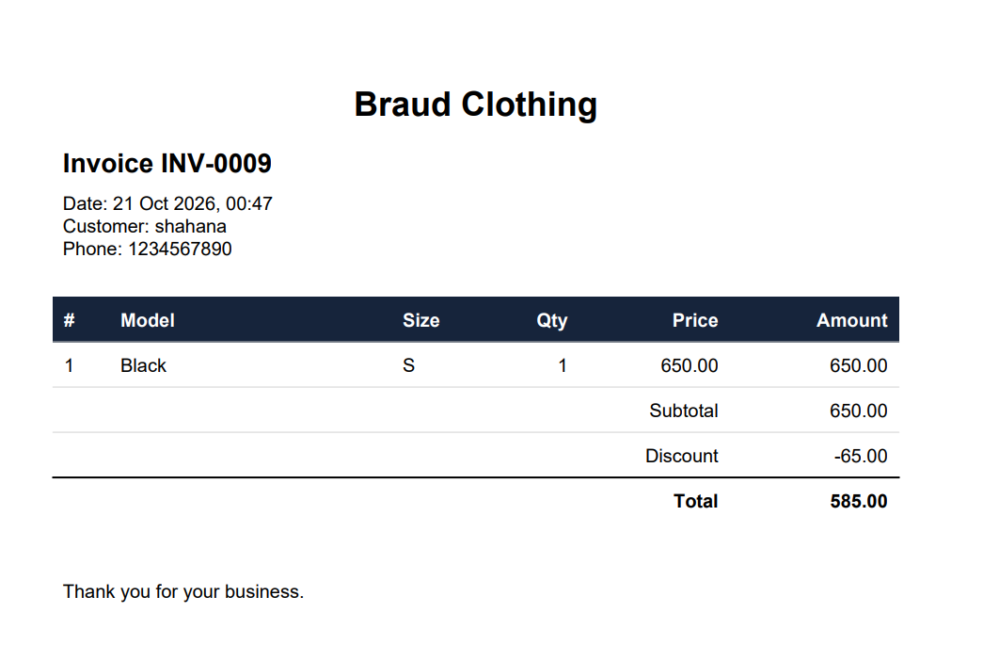

# 👕 Braud Clothing: Stock & Billing Manager

A web app for a clothing shop to track shirt stock by size, create bills with PDF invoices, and see what is running low, all from one login-protected dashboard.


## 📑 Quick links
[Features](#-features) · [Screenshots](#-screenshots) · [Setup](#-setup) · [How to use](#-how-to-use) · [Project structure](#-project-structure) · [Security](#-security-notes) · [Troubleshooting](#-troubleshooting) · [Support](#-support)

---

## ✨ Features

- 🔐 **Secure login**: admin username and hashed password; every page is protected
- 🏠 **Home dashboard**: total shirts in stock, low/out-of-stock models, today's sales and bill count
- 📦 **Add Stock by sets**: one set adds 1 piece each of S, M, L, XL
- 📊 **Stock Status**: see what is left per model and size, marked **OK / Low / Out**
- 👕 **Products**: add models with a price and a low-stock warning limit, and edit them later
- 🧾 **Billing**: multi-item bills, stock check before saving, percent or fixed discount
- 📄 **PDF invoices**: download a bill as PDF (`INV-0001`, `INV-0002`, ...)
- ❌ **Cancel bills**: cancel with a reason, and stock is added back automatically
- 🛠️ **Correct Stock**: fix a wrong stock number with a reason, and every change is logged

## 📸 Screenshots

| Login | Home dashboard |
|---|---|
|  |  |

| Billing | Invoices |
|---|---|
|  |  |


## 🚀 Setup

<details>
<summary><b>Step 1: Install (click to expand)</b></summary>

Requirements: Python 3.9 or newer.

```powershell
git clone https://github.com/YOUR-USERNAME/YOUR-REPO.git
cd YOUR-REPO
python -m venv venv
venv\Scripts\activate
pip install -r requirements.txt
```
</details>

<details>
<summary><b>Step 2: Create your .env file</b></summary>

```powershell
copy .env.example .env
```

| Variable | What it is |
|---|---|
| `SECRET_KEY` | Random key Flask uses to protect login sessions |
| `ADMIN_USER` | Username for logging in |
| `ADMIN_HASH` | Hashed (scrambled) version of the admin password |

**Generate a secret key:**
```powershell
python -c "import secrets; print(secrets.token_hex(32))"
```

**Generate the password hash** (it asks you to type the password):
```powershell
python -c "from werkzeug.security import generate_password_hash; import getpass; print(generate_password_hash(getpass.getpass('Password: ')))"
```

Put the results in `.env`. Wrap the hash in **single quotes** because it contains `$` characters:
```
SECRET_KEY=your_long_random_key
ADMIN_USER=your_username
ADMIN_HASH='scrypt:32768:8:1$...'
```

You log in with the **plain password** you typed, not the hash.
</details>

<details>
<summary><b>Step 3: Run the app</b></summary>

```powershell
python app.py
```
Open **http://127.0.0.1:5000** and log in. The database is created automatically on the first run.

**For daily use on a Windows PC:**
```powershell
pip install waitress
waitress-serve --port=5000 app:app
```
Other devices on the same Wi-Fi can open `http://PC-IP-ADDRESS:5000`.

**For Linux hosting:**
```bash
gunicorn app:app
```
</details>

---

## 📖 How to use

<details>
<summary><b>🔐 Log in / Log out</b></summary>


Enter your username and password. Click **Log out** in the top menu when you finish.
</details>

<details>
<summary><b>🏠 Home dashboard</b></summary>


The home page shows total shirts in stock, how many models are low or out, and today's sales. The cards open each section of the app.
</details>

<details>
<summary><b>👕 Add a new shirt model</b></summary>

1. Go to **Products**.
2. Enter the model name, price, and a **warning limit** (when total stock falls below this number, the model shows as *Low*).
3. Click add. The model gets sizes S, M, L and XL with 0 stock.

To change a price or limit later, click **Edit** next to the model.
</details>

<details>
<summary><b>📦 Add stock when new shirts arrive</b></summary>

1. Go to **Add Stock**.
2. Choose the model and enter the **number of sets**.
3. Save. Each set adds 1 piece of every size, so 3 sets = 3 each of S, M, L, XL (12 pieces).
</details>

<details>
<summary><b>🧾 Make a bill</b></summary>


1. Go to **Billing**.
2. Enter the customer name and phone.
3. Pick the model, size and quantity for each item. Use **+ Add item** for more rows.
4. Add a discount if needed, either **%** or a fixed amount.
5. Check the live subtotal, discount and total, then click **Save bill**.
6. Stock is reduced automatically, and the app blocks the bill if there isn't enough stock.
</details>

<details>
<summary><b>📄 Download the invoice PDF</b></summary>


Open **Invoices** and click the PDF link next to any bill to download it.
</details>

<details>
<summary><b>❌ Cancel a bill</b></summary>

1. Go to **Invoices**.
2. Click cancel on the bill and enter a **reason**.
3. The bill is marked *Cancelled* and the shirts go back into stock.
</details>

<details>
<summary><b>🛠️ Fix a wrong stock number</b></summary>

1. Go to **Correct Stock**.
2. Choose the model and size, enter the correct quantity and a reason (for example "counted again").
3. Save. The change is recorded in the recent adjustments list.
</details>

<details>
<summary><b>📊 Check what is running low</b></summary>

Open **Stock Status** to see every model by size, with a status of **OK**, **Low** or **Out**.
</details>

---

## 🗂️ Project structure

```
app.py            # Routes and main logic
models.py         # Database tables (Product, Variant, Invoice, ...)
invoice.py        # Builds the PDF invoice
fix_names.py      # One-time utility script
templates/        # HTML pages
static/           # CSS, images, logo
docs/             # README screenshots
instance/         # Database (not uploaded to GitHub)
.env.example      # Template for environment variables
requirements.txt  # Python packages
```

## 🛡️ Security notes

- Never upload `.env`, `venv/` or the database to GitHub.
- Keep `SECRET_KEY` and `ADMIN_HASH` private.
- Before going live, set `app.run(debug=False)` in `app.py` (waitress and gunicorn ignore it).
- Back up the database regularly (copy it to a USB drive or cloud storage).
- Change the admin password if it was ever shared or exposed.

## 🧰 Troubleshooting

<details>
<summary><b>KeyError: 'SECRET_KEY' (or ADMIN_USER / ADMIN_HASH) when starting</b></summary>

Your `.env` file is missing or a variable is not filled in. Check that it is named exactly `.env` and sits next to `app.py`.
</details>

<details>
<summary><b>"Wrong username or password" with the correct password</b></summary>

Make sure `ADMIN_HASH` is pasted in full, inside single quotes, with no line breaks. Regenerate it if unsure.
</details>

<details>
<summary><b>"Not enough stock" when billing</b></summary>

The model or size doesn't have enough pieces. Check **Stock Status**, then use **Add Stock** or **Correct Stock**.
</details>

<details>
<summary><b>Start with a clean database</b></summary>

Stop the app, delete the database file (`braud.db`), and start the app again. **This deletes all data**, so back it up first.
</details>

Built with Flask, SQLAlchemy and SQLite.

## 🚀 Setup

<details>
<summary><b>Step 1: Install (click to expand)</b></summary>

Requirements: Python 3.9 or newer.

```powershell
git clone https://github.com/YOUR-USERNAME/YOUR-REPO.git
cd YOUR-REPO
python -m venv venv
venv\Scripts\activate
pip install -r requirements.txt
```
</details>

<details>
<summary><b>Step 2: Create your .env file</b></summary>

```powershell
copy .env.example .env
```

| Variable | What it is |
|---|---|
| `SECRET_KEY` | Random key Flask uses to protect login sessions |
| `ADMIN_USER` | Username for logging in |
| `ADMIN_HASH` | Hashed (scrambled) version of the admin password |

**Generate a secret key:**
```powershell
python -c "import secrets; print(secrets.token_hex(32))"
```

**Generate the password hash** (it asks you to type the password):
```powershell
python -c "from werkzeug.security import generate_password_hash; import getpass; print(generate_password_hash(getpass.getpass('Password: ')))"
```

Put the results in `.env`. Wrap the hash in **single quotes** because it contains `$` characters:
```
SECRET_KEY=your_long_random_key
ADMIN_USER=your_username
ADMIN_HASH='scrypt:32768:8:1$...'
```

You log in with the **plain password** you typed, not the hash.
</details>

<details>
<summary><b>Step 3: Run the app</b></summary>

```powershell
python app.py
```
Open **http://127.0.0.1:5000** and log in. The database is created automatically on the first run.

**For real daily use (Windows PC):**
```powershell
pip install waitress
waitress-serve --port=5000 app:app
```
Other devices on the same Wi-Fi can open `http://PC-IP-ADDRESS:5000`.

**For Linux hosting:**
```bash
gunicorn app:app
```
</details>

---

## 📖 How to use

<details>
<summary><b>🔐 Log in / Log out</b></summary>

Open the site and enter your username and password. Click **Log out** in the top menu when you finish.
</details>

<details>
<summary><b>👕 Add a new shirt model</b></summary>

1. Go to **Products**.
2. Enter the model name, price, and a **warning limit** (when total stock falls below this number, the model shows as *Low*).
3. Click add. The model gets sizes S, M, L and XL with 0 stock.

To change a price or limit later, click **Edit** next to the model.
</details>

<details>
<summary><b>📦 Add stock when new shirts arrive</b></summary>

1. Go to **Add Stock**.
2. Choose the model and enter the **number of sets**.
3. Save. Each set adds 1 piece of every size, so 3 sets = 3 each of S, M, L, XL (12 pieces).
</details>

<details>
<summary><b>🧾 Make a bill</b></summary>

1. Go to **Billing**.
2. Enter the customer name and phone.
3. Pick the model, size and quantity for each item (add more rows if needed).
4. Add a discount if needed, either **percent** or a **fixed amount**.
5. Save. Stock is reduced automatically, and the app blocks the bill if there isn't enough stock.
6. Open **Invoices** to download the PDF.
</details>

<details>
<summary><b>❌ Cancel a bill</b></summary>

1. Go to **Invoices**.
2. Click cancel on the bill and enter a **reason**.
3. The bill is marked *Cancelled* and the shirts go back into stock.
</details>

<details>
<summary><b>🛠️ Fix a wrong stock number</b></summary>

1. Go to **Correct Stock**.
2. Choose the model and size, enter the correct quantity and a reason (for example "counted again").
3. Save. The change is recorded in the recent adjustments list.
</details>

<details>
<summary><b>📊 Check what is running low</b></summary>

Open **Stock Status** to see every model by size, with a status of **OK**, **Low** or **Out**. The home page also shows how many models need attention.
</details>

---

## 🗂️ Project structure

```
app.py            # Routes and main logic
models.py         # Database tables (Product, Variant, Invoice, ...)
invoice.py        # Builds the PDF invoice
fix_names.py      # One-time utility script
templates/        # HTML pages
static/           # CSS, images, logo
instance/         # Database (not uploaded to GitHub)
.env.example      # Template for environment variables
requirements.txt  # Python packages
```

## 🛡️ Security notes

- Never upload `.env`, `venv/` or `instance/` (the database) to GitHub.
- Keep `SECRET_KEY` and `ADMIN_HASH` private.
- Before going live, change `app.run(debug=True)` in `app.py` to `debug=False` (or use waitress/gunicorn, which ignore it).
- Back up the database file regularly (copy it to a USB drive or cloud storage).
- Change the admin password if it was ever shared or exposed.

## ✅ Delivery checklist

- [ ] `.env` created with a new `SECRET_KEY` and `ADMIN_HASH`
- [ ] `debug` is turned off
- [ ] Test login works with the new password
- [ ] Test a full flow: add product → add stock → make bill → download PDF → cancel bill
- [ ] Backup of `instance/` set up
- [ ] Client has received the login details through a safe channel

## 🧰 Troubleshooting

<details>
<summary><b>KeyError: 'SECRET_KEY' (or ADMIN_USER / ADMIN_HASH) when starting</b></summary>

Your `.env` file is missing or a variable is not filled in. Check that the file is named exactly `.env` and sits in the project folder next to `app.py`.
</details>

<details>
<summary><b>"Wrong username or password" with the correct password</b></summary>

Make sure `ADMIN_HASH` is pasted in full, inside single quotes, with no line breaks. Regenerate the hash if unsure.
</details>

<details>
<summary><b>"Not enough stock" when billing</b></summary>

The model/size doesn't have enough pieces. Check **Stock Status**, then use **Add Stock** or **Correct Stock**.
</details>

<details>
<summary><b>I want to start with a clean database</b></summary>

Stop the app, delete the database file inside `instance/` (`braud.db`), and start the app again. **This deletes all data**, so back it up first.
</details>

## 💬 What users say

> "[Add a real quote from the client here after they've used the app]"
> **[Name]**, Braud Clothing

## 📞 Support

Developer: **[Athila Ashraf]**


When you report a problem, please include the page, what you did, what happened, and a screenshot.

---
Built with Flask, SQLAlchemy and SQLite.
